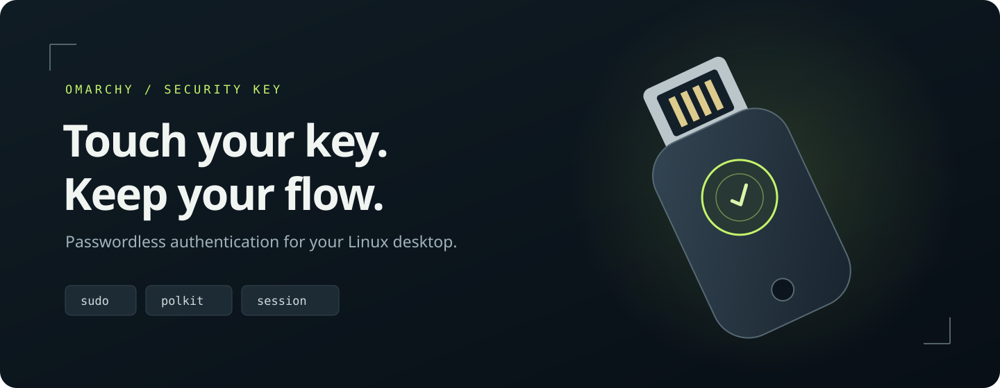

<p align="center">
  
</p>

<p align="center">
  Security-key authentication for sudo, your Omarchy session and optional LUKS2 boot unlock.
</p>

<p align="center">
  <a href="LICENSE"></a>
  <a href="https://github.com/marselnenaj/omarchy-yubikey/releases/tag/v0.1.1"></a>
  
  <a href="https://github.com/marselnenaj/omarchy-yubikey/actions/workflows/checks.yml"></a>
</p>

<p align="center">
  <a href="#what-you-get">Features</a> ·
  <a href="#getting-started">Getting started</a> ·
  <a href="docs/pam-setup.md">PAM setup</a> ·
  <a href="docs/keyring.md">Keyring helper</a> ·
  <a href="docs/luks.md">LUKS boot unlock</a> ·
  <a href="docs/security-model.md">Security model</a> ·
  <a href="CONTRIBUTING.md">Contributing</a>
</p>

## Why this exists

You already have a security key on your desk. Use a touch to approve `sudo`,
authorize a privileged desktop action or unlock your screen, with a password
available when the key is absent.

**Omarchy YubiKey** brings these pieces together: PAM configuration examples,
a theme-aware Polkit agent, a session-lock plugin and an optional Rust helper.
Choose the parts you need. The PAM route also works without the plugins.

## What you get

| Component | What it does | Start here |
| --- | --- | --- |
| **Passwordless sudo** | Authenticate through `pam_u2f`, then fall back to the existing password stack | [PAM setup](docs/pam-setup.md) |
| **Polkit dialog** | Show a touch prompt while PAM waits; keep fingerprint and password prompts | [Shell plugins](docs/plugins.md) |
| **Screen unlock** | Run FIDO2, password and optional fingerprint flows in parallel | [Shell plugins](docs/plugins.md) |
| **GNOME Keyring** | Decrypt a saved keyring password with the key's `hmac-secret`, then unlock over D-Bus | [Keyring helper](docs/keyring.md#gnome-keyring) |
| **LUKS2 boot unlock** | Enroll disk-unlock keys with PIN plus touch; integrate boot separately with a manual guide | [LUKS setup](docs/luks.md) |

**Passwordless PAM and the optional helper work differently.** PAM verifies a
security-key assertion. The helper recovers an existing password from an
encrypted local store. It does not add native passkey login to GNOME Keyring.

## Getting started

Run the guided installer from an interactive terminal:

```sh
git clone --depth 1 --branch v0.1.1 https://github.com/marselnenaj/omarchy-yubikey.git && ./omarchy-yubikey/install.sh
```

Already cloned? Run `./install.sh` from the checkout. The wizard lets you choose
sudo, desktop authentication and optional GNOME Keyring unlock. It installs
needed packages, enrolls your key, backs up changed files and walks you through
the password/key checks. **Keep a separate recovery root shell open until the
checks pass.** [Installation and rollback](docs/install.md) explains each step.

LUKS enrollment is a separate opt-in command: `./install.sh --luks --device /dev/your-luks-partition`.
It requests PIN plus touch and preserves the disk passphrase. Boot configuration
is a manual step; read the [LUKS guide](docs/luks.md) first.

**v0.1.1 is released**, with [source archives and checksums](https://github.com/marselnenaj/omarchy-yubikey/releases/tag/v0.1.1).
The [release notes](docs/releases/0.1.1.md) describe validation and compatibility.
For manual setup or a custom PAM stack, see [PAM setup](docs/pam-setup.md).
Touch-only authentication does not request a FIDO2 PIN; see the
[security model](docs/security-model.md).

### Requirements and compatibility

| Part | Requirements |
| --- | --- |
| PAM | Arch Linux, `pam-u2f`, a compatible U2F/FIDO2 key and a working password fallback |
| Shell plugins | Omarchy 4 with the Quickshell plugin host, `qs.Commons`, `qs.Ui`, authentication-clone support and the shell's PAM/Polkit modules |
| Rust helper | Linux, Rust/Cargo, libfido2, OpenSSL, libudev, pkg-config and Clang build tools; a FIDO2 key with `hmac-secret` |
| Keyring | GNOME Keyring on the user's session bus and an existing default collection |
| LUKS | Existing LUKS2 volume, known passphrase, FIDO2 `hmac-secret` key with PIN, cryptsetup/systemd/libfido2; boot guide targets reviewed mkinitcpio/Limine setups |

The source environment used Omarchy **4.0.6**, libfido2 **1.17.0** and pam-u2f
**1.4.0**. Other shell versions and security-key models are unqualified. A key
that works with PAM may lack the extension needed by the Rust helper. NFC and
other desktops are not qualified.

## Individual shell plugins

The full guided installer is the easiest route. If PAM is already configured,
there are also standalone source repositories for the
[Polkit agent](https://github.com/marselnenaj/omarchy-yubikey-polkit) and
[lock screen](https://github.com/marselnenaj/omarchy-yubikey-lock). Each has a
root manifest for standard `omarchy plugin add` installation. Follow their
installation and removal instructions; do not install a second copy over a
plugin already managed by the suite. Marketplace approval is separate from a
GitHub release and is not a security certification.

## Build and check

On Arch, install build dependencies:

```sh
sudo pacman -S --needed base-devel rust clang pkgconf libfido2 openssl systemd-libs
cargo build --release --locked
cargo test --workspace --locked
cargo fmt --all -- --check
node --test tests/*.test.cjs
python3 -m unittest discover -s tests -p 'test_*.py'
python3 scripts/check-publication.py
```

The helper interface and source comments currently use German. The shell
prompts use English. See [development](CONTRIBUTING.md) for validation details.

## Documentation

- [Guided installation and rollback](docs/install.md)
- [PAM enrollment, configuration and rollback](docs/pam-setup.md)
- [Install, activate and remove the shell plugins](docs/plugins.md)
- [Build, enroll and run the optional helper](docs/keyring.md)
- [Optional LUKS2 enrollment, boot integration and recovery](docs/luks.md)
- [Security properties, data locations and limitations](docs/security-model.md)
- [Publication checklist](docs/publication.md)
- [Contributing](CONTRIBUTING.md) · [Security reporting](SECURITY.md) · [Changelog](CHANGELOG.md)

## License and credits

MIT. The QML plugins derive from the Omarchy shell; see
[third-party notices](THIRD_PARTY_NOTICES.md). Rust dependencies retain their own
licenses. This is an independent community project, unaffiliated with Yubico,
GNOME or Omarchy.
